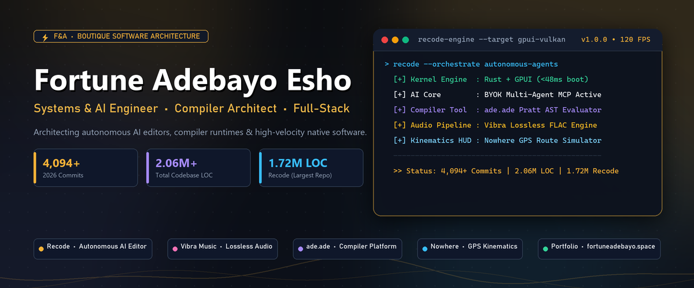

  

    

  

    
    
    
    
  

  

    <strong>Founder & Lead Systems Architect at <a href="https://fortuneadebayo.space/">F&A</a></strong> 
    <em>"Architecting autonomous AI editors, modular compiler toolchains, native GPU software, and resilient full-stack systems."</em>
  

  

    
    
    
    
    
  

---

### 👨‍💻 Executive Summary

I am a **Systems & AI Engineer, Full-Stack Developer, and DevOps Specialist** dedicated to building high-performance native desktop tools, autonomous AI agents, programming language compilers, and polished Android applications. Whether designing native GPU-accelerated code editors in Rust, architecting modular compiler runtimes, or engineering high-throughput automation engines, I build software engineered for speed, autonomy, and craftsmanship.

- ⚡ **Autonomous AI & Developer Tooling:** Creator of [Recode](https://github.com/Fortunehack45/Recode) (GPU-accelerated AI code editor in Rust with GPUI) and [Northveil-MCP](https://github.com/Fortunehack45/Northveil-MCP) (Model Context Protocol tooling for autonomous AI agents).
- 🎵 **Native Mobile & Audio Systems:** Creator of [Vibra Music](https://github.com/Fortunehack45/Vibra_Music) (Lossless Android YouTube Music client with gapless playback & dynamic canvas art) and [Nowhere](https://github.com/Fortunehack45/Nowhere) (GPS kinematics route simulator).
- 🔧 **Compiler & Language Infrastructure:** Architect of [Ade (`ade.ade`)](https://github.com/Fortunehack45/ade.ade) — an independent language with a recursive-descent Pratt parser, AST evaluator, and modular language-building platform.
- ⛓️ **Distributed Systems & Web3:** Experienced with Solidity smart contracts, Base blockchain, Soulbound NFTs, ZK income verification (Reclaim Protocol), and DAG consensus research.
- 🎓 **Alumni:** Federal University of Technology, Akure (FUTA).
- 💬 **Ask me about:** Rust / GPUI, Autonomous AI Agents, Model Context Protocol (MCP), Pratt Parsers, Android / Kotlin, Flutter / Dart, or System Design.

---

### 📈 2026 Engineering Impact & Verified Metrics

  

    
    
    
    
  

<table>
  <thead>
    <tr>
      <th align="left">📈 Engineering Metric</th>
      <th align="center">⚡ Verified Value</th>
      <th align="left">🔍 Architectural Scope & Performance Highlights</th>
    </tr>
  </thead>
  <tbody>
    <tr>
      <td><strong>Total Commits This Year (2026)</strong></td>
      <td align="center"><strong><code>4,094+</code> Commits</strong></td>
      <td>Verified annual commit volume across native applications, autonomous agent systems, and compilers</td>
    </tr>
    <tr>
      <td><strong>Total Annual Contributions (2026)</strong></td>
      <td align="center"><strong><code>4,199+</code> Contributions</strong></td>
      <td>Aggregated GitHub contributions including commits, pull requests, and multi-platform binary releases</td>
    </tr>
    <tr>
      <td><strong>All-Time Verified Contributions</strong></td>
      <td align="center"><strong><code>4,431+</code> Contributions</strong></td>
      <td>Continuous engineering output featuring a 36-day active streak and 59-day peak record streak</td>
    </tr>
    <tr>
      <td><strong>Total Lines of Code (Across All Repos)</strong></td>
      <td align="center"><strong><code>2,062,109+</code> LOC</strong></td>
      <td>Over <strong>2.06 Million lines of verified code</strong> engineered across Rust, Kotlin, Python, TypeScript, and Dart</td>
    </tr>
    <tr>
      <td><strong>Largest Repository by Code Volume</strong></td>
      <td align="center"><strong><a href="https://github.com/Fortunehack45/Recode"><code>Recode</code></a></strong></td>
      <td><strong><code>1,720,390</code> Lines of Code</strong> across 2,941 source files (Native GPU Rust, GPUI, agent loops & SDK)</td>
    </tr>
    <tr>
      <td><strong>Secondary Flagship Codebases</strong></td>
      <td align="center"><strong><code>340,000+</code> LOC</strong></td>
      <td><strong>Northveil</strong> (~98k LOC), <strong>Bt</strong> (~43k LOC), <strong>Nowhere</strong> (~34k LOC), <strong>TC</strong> (~31k LOC), <strong>Vibra Music</strong> (~10MB codebase)</td>
    </tr>
    <tr>
      <td><strong>Active Repositories Engineered</strong></td>
      <td align="center"><strong><code>100+</code> Repositories</strong></td>
      <td>46 public open-source tools and libraries alongside 54 specialized backend services</td>
    </tr>
  </tbody>
</table>

---

### 🛠️ Tech Stack & Arsenal

#### 💻 Core Programming Languages

  
  
  
  
  
  
  
  
  
  

#### ⚡ Systems, Native GPU & Autonomous AI

  
  
  
  
  
  
  
  
  

#### 📱 Mobile & Cross-Platform Frameworks

  
  
  
  
  
  
  
  

#### 🌐 Frontend & Web Engineering

  
  
  
  
  
  

#### 🗄️ Backend, Cloud & Distributed Infrastructure

  
  
  
  
  
  
  
  
  
  

---

### 🚀 Flagship Project Showcase

<table>
  <tr>
    <td>
      <h3>⚡ <a href="https://github.com/Fortunehack45/Recode">Recode</a></h3>
      
<strong>The Autonomous AI Code Editor. Built for Speed, Multi-Model Precision & Native GPU Performance.</strong>

      
An open-source, native GPU-accelerated code editor engineered in pure Rust with GPUI. Combines instantaneous cold boot (&lt;50ms) and silky 120 FPS rendering with a deeply integrated autonomous AI coding agent, multi-file atomic diff engine, full Model Context Protocol (MCP) ecosystem, Bring Your Own Key (BYOK) privacy, terminal CLI (<code>recode</code>), and programmatic <code>@recode/sdk</code>.

      

        
        
        
        
        
        
        
      

    </td>
  </tr>
  <tr>
    <td>
      <h3>🎵 <a href="https://github.com/Fortunehack45/Vibra_Music">Vibra Music</a></h3>
      
<strong>Aesthetic Hi-Res Lossless Music Player & YouTube Music Client for Android</strong>

      
A native Android audio client featuring Hi-Res lossless FLAC/ALAC playback, gapless transitions, DJ automix, offline downloads with embedded ID3 metadata, animated album artwork canvas, word-synced lyrics, Discord Rich Presence, and a Telegram-style frosted-glass Material 3 interface.

      

        
        
        
        
        
        
      

    </td>
  </tr>
  <tr>
    <td>
      <h3>⚡ <a href="https://github.com/Fortunehack45/ade.ade">ade.ade</a></h3>
      
<strong>Independent Programming Language & Modular Compiler Platform</strong>

      
A modern programming language and compiler framework designed for building DSLs, script engines, and custom language runtimes. Features a recursive-descent Pratt parser, clean block syntax, human-centric error diagnostics, and a decoupled compiler pipeline spanning lexing, pure AST evaluation, and intermediate representation (Ade IR).

      

        
        
        
        
        
      

    </td>
  </tr>
  <tr>
    <td>
      <h3>📍 <a href="https://github.com/Fortunehack45/Nowhere">Nowhere</a></h3>
      
<strong>Precision Android GPS & Route Simulator Engine</strong>

      
An Android mock-location engine and route simulation suite with a luxury Red & White aesthetic. Features interactive OpenStreetMap waypoint routing, realistic kinematics acceleration physics (2 m/s² launch, centripetal curve deceleration), military-grade radar joystick HUD, Room DB search history, and GPX trackpoint import.

      

        
        
        
        
        
        
      

    </td>
  </tr>
  <tr>
    <td>
      <h3>🧩 <a href="https://github.com/Fortunehack45/Northveil-MCP">Northveil MCP & Developer SDK</a></h3>
      
<strong>Model Context Protocol Infrastructure for Autonomous AI Agents</strong>

      
A modular Model Context Protocol (MCP) server suite and developer SDK enabling coding agents and LLM runtimes to inspect live codebases, execute verified terminal tool calls, interact with relational databases, and manage multi-file atomic edits with structured context schemas.

      

        
        
        
        
        
      

    </td>
  </tr>
</table>

---

### 📊 GitHub Activity & Engineering Metrics

  <!-- Live Real-Time Dynamic GitHub Statistics (Direct from GitHub API) -->
  
    
  
    
  
    

  <!-- Detailed Profile Contributions & Stars Summary Card -->
  
    

  <!-- Language Breakdown & Distribution Charts -->
  
    
  
    

  <!-- Pinned Flagship Repository Highlights -->
  
    
  

---

### 🌐 Let's Build Together

Whether you want to collaborate on native GPU applications, autonomous AI agents, compiler toolchains, or high-throughput backends:

- 💻 **Official Portfolio:** [fortuneadebayo.space](https://fortuneadebayo.space/)
- 𝕏 **Twitter / X:** [@OnNerd_eth](https://x.com/OnNerd_eth)
- 💼 **LinkedIn:** [Fortune Adebayo Esho](https://www.linkedin.com/in/fortune-esho-79793b417)
- 📬 **Direct Email:** [fortunedomination@gmail.com](mailto:fortunedomination@gmail.com)

  Designed & engineered with precision by Fortune Adebayo Esho (F&A).

